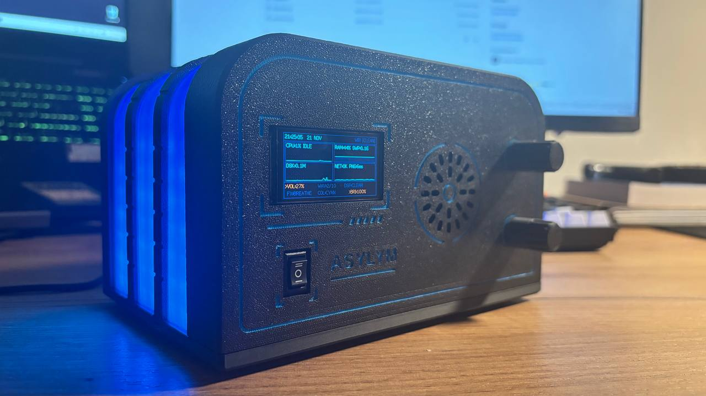
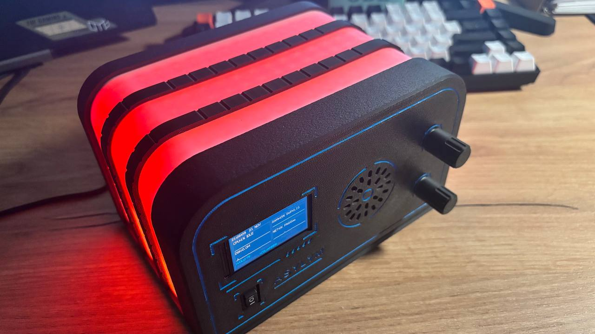
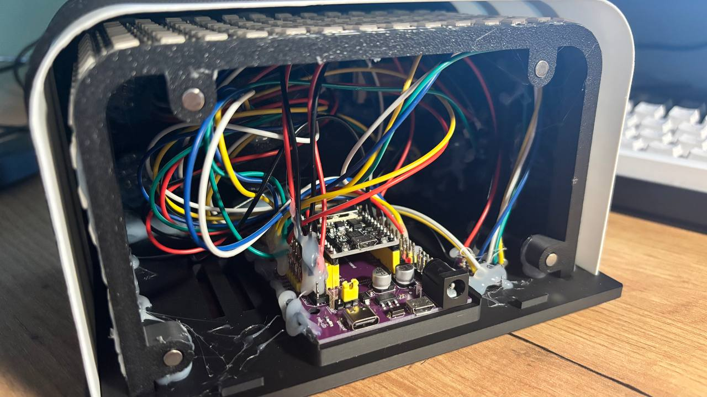
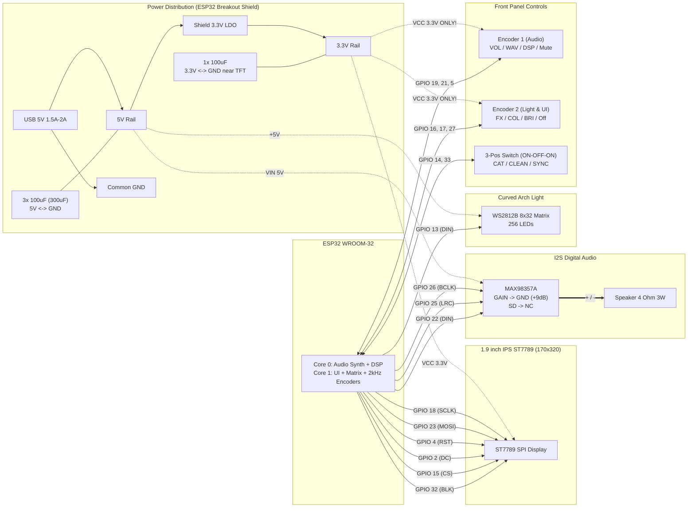
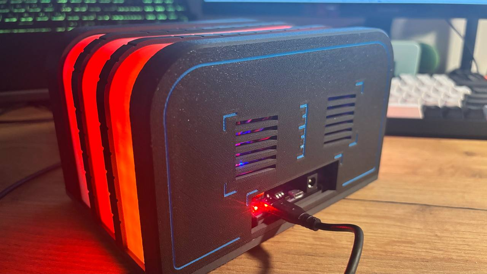
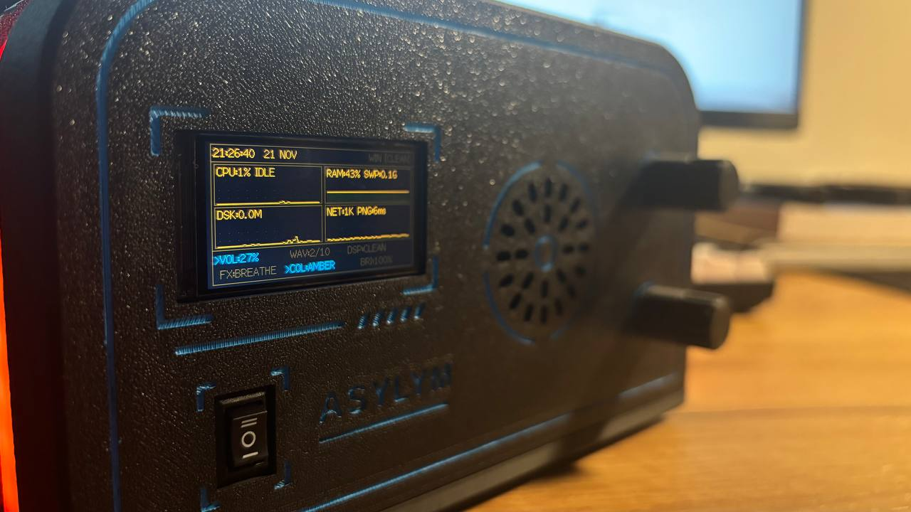
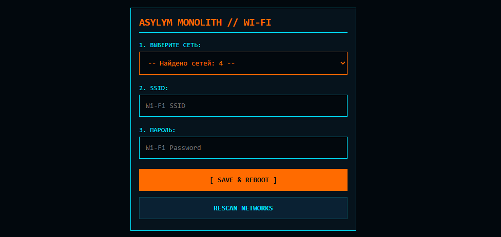
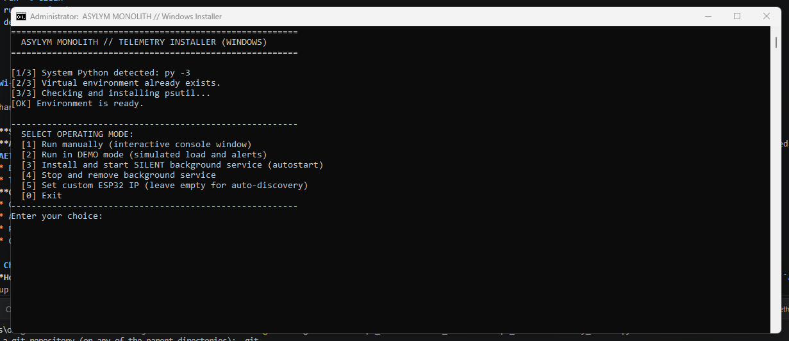

# ASYLYM MONOLITH (SCOPE-01)

> A retro-futuristic desktop ambient synthesizer, curved LED mood lamp, and real-time PC telemetry oscilloscope powered by ESP32.



---

## Table of Contents

1. [Overview & Key Features](#overview--key-features)
2. [Repository Structure](#repository-structure)
3. [Bill of Materials (BOM)](#bill-of-materials-bom)
4. [Wiring & Pinout](#wiring--pinout)
5. [3D Printing Guide](#3d-printing-guide)
6. [Painting the Recessed Panel Grooves](#painting-the-recessed-panel-grooves)
7. [Mechanical & Glue Assembly Guide](#mechanical--glue-assembly-guide)
8. [Firmware Build & Flashing](#firmware-build--flashing)
9. [Wi-Fi Setup (Captive Portal) & OTA](#wi-fi-setup-captive-portal--ota)
10. [Controls & Operating Modes](#controls--operating-modes)
11. [PC Telemetry Daemon (Windows & macOS)](#pc-telemetry-daemon-windows--macos)
12. [Troubleshooting](#troubleshooting)
13. [License](#license)


## Overview & Key Features

**ASYLYM MONOLITH (SCOPE-01)** is an open-source, self-contained sci-fi desk instrument designed around a horizontal curved arch silhouette (`178 × 126 mm` footprint). It runs completely standalone out of the box and optionally pairs over Wi-Fi with a lightweight cross-platform PC daemon.

* **Procedural Generative Audio Engine (Core 0):** Real-time 22.05 kHz I2S synthesizer driving a MAX98357A Class-D amplifier. Features **10 musical styles** (Lo-Fi Chill, Synthwave, Space Trance, Dub Techno, Stalker Post, Ambient Drone, Blade Runner, Cyberpunk, Solaris Piano, Deep House) with hardware-TRNG non-repeating A/A'/B/Bridge progressions and **7 musical DSP modes** (`CLEAN`, `BUNKER` LPF, `TAPE`, `PHASER`, `TREMOLO`, `SPACE`, `SWEEP`) — no harsh static noise.
* **Curved Arch Ambient Lighting (Core 1):** Flexible 8×32 WS2812B LED matrix diffused through a `0.84 mm` matte white shell. Includes **8 slow, non-distracting ambient shaders** (`LAVA`, `BREATHE`, `BLOOM`, `TIDE`, `SECTIONS`, `HORIZON`, `RIPPLE`, `TWILIGHT`) with current-limited (`480 mA`) perceptual gamma brightness control from `0%` to `100%`.
* **Unified Color Themes (LED + UI Sync):** **6 curated palettes** (`AMBER`, `CYAN`, `EMERALD`, `VIOLET`, `CRIMSON`, `OCEAN`) that switch the LED arch and the 1.9" IPS display simultaneously.
* **Three Physical Operating Modes (3-Pos Switch):**
  * **`[CAT]`** — Hides telemetry graphs and displays a live pixel-art night scene with a wandering, sitting, and sleeping cat that reacts to your active DSP mode.
  * **`[CLEAN]`** — Four live scrolling oscilloscopes (`CPU`, `RAM/SWAP`, `Disk I/O + Temp`, `Net + Ping`) plus synchronized PC clock & date in the header.
  * **`[SYNC]`** — Smoothly modulates LED animation speed based on PC CPU load, overlays visual alerts on the arch edges (`SWAP`, `THERMAL`, `NET`), and applies gentle audio slow-motion during critical system alerts.
* **Zero-Reflash Wi-Fi Provisioning:** Built-in Captive Portal (`AETHER-MONOLITH` / `192.168.4.1`) with network scanning and NVS storage, plus `aether-monolith.local` mDNS and ArduinoOTA.
* **Ultra-Low-CPU PC Daemon:** Single-file Python script (~`0.0–0.1%` CPU usage, zero spawned `ping.exe` subprocesses) with one-click installers and silent background service managers for both **Windows** and **macOS**.




## Repository Structure

```text
asylym-monolith/
├── platformio.ini                   # PlatformIO build configuration
├── src/
│   ├── config.h                     # Pins, safe screen margins, current & gain limits
│   ├── types.h                      # Shared state structs, enums, mode labels
│   ├── themes.h / themes.cpp        # 6 unified LED + ST7789 color themes
│   ├── controls.h / controls.cpp    # 2 kHz timer quadrature Gray-code encoders & switch
│   ├── audio_engine.h / .cpp        # 10-style procedural composer & 6 musical DSPs
│   ├── matrix_fx.h / .cpp           # 8 ambient arch shaders + current-aware brightness
│   ├── net_manager.h / .cpp         # Wi-Fi, Captive Portal, mDNS, OTA, UDP receiver
│   ├── ui.h / ui.cpp                # ST7789 HUD, oscilloscopes, pixel-art [CAT] scene
│   └── main.cpp                     # FreeRTOS entry point & main loop
├── pc_daemon/
│   ├── telemetry_daemon.py          # Cross-platform UDP telemetry sender (Win & macOS)
│   ├── install_win.bat              # One-click Windows installer & service manager
│   └── install_mac.command          # One-click macOS installer & LaunchAgent manager
├── cad/
│   ├── AsylymEnclosureV2.scad
│   ├── AsylymEnclosureV2.stl
│   ├── AsylymDiffusor.3mf
│   └── AsylymBody.3mf               
└── docs/images/                     # Build & showcase photos
```


## Bill of Materials (BOM)

### Electronics
| Qty | Component | Notes |
| :---: | :--- | :--- |
| 1 | **ESP32-WROOM-32 DevKit** (30 or 38-pin) | Standard ESP32 (no S2/C3 needed) |
| 1 | **ESP32 Breakout Expansion Shield** (`75 × 53 mm`) | Provides 5V / 3.3V / GND screw/pin rails and USB-C / Micro-USB / DC power |
| 1 | **1.9" IPS TFT Display (ST7789)** | `170 × 320` resolution, SPI interface, 3.3V logic (`62 × 29 mm` PCB) |
| 1 | **MAX98357A I2S Amplifier** | 3W Class-D mono digital amp |
| 1 | **Speaker, 4 Ω 3 W** | `40 mm` or `50 mm` (match to your `front_frame` cup diameter in OpenSCAD) |
| 1 | **Flexible WS2812B 8×32 LED Matrix** | `80 × 320 mm`, 256 LEDs, serpentine layout |
| 2 | **Rotary Encoders (EC11 / KY-040 round PCB)** | With push-button, M7 thread, 18- or 20-tooth spline shaft (`Ø6 mm`) |
| 1 | **3-Position Rocker / Toggle Switch** (`ON-OFF-ON`) | 3 pins (`1a` – `COM` – `1b`), rectangular frame |
| 4 | **Electrolytic Capacitors `100 µF` (10V–16V)** | 3× (`300 µF` total) across 5V/GND for LED rail; 1× across 3.3V/GND near ST7789 to eliminate backlight flicker |
| 1 | **USB-C Power Supply (5V / 1.5A–2A)** | Standard phone charger or powered USB port |
| — | **Hookup Wire / Dupont Jumpers** | 24–26 AWG silicone wire recommended for clean internal routing |

### Mechanical & Consumables
| Qty | Item | Purpose |
| :---: | :--- | :--- |
| 8 | **Neodymium Magnets (`Ø5 × 3 mm`)** | 4 mating pairs for the tool-free magnetic rear cover (`rear_frame`) |
| 1 | **Cyanoacrylate Gel (Super Glue) or B-7000** | Structural joints, magnet seating, speaker sealing |
| 1 | **Acrylic Paint (Accent Color)** | Filling `0.65 mm` recessed sci-fi panel grooves (e.g., vibrant orange or cyan) |
| 1 | **1–2 ml Syringe + Blunt 18G–20G Needle** | Clean capillary filling of engraved grooves (optional: wipe-off wash method) |
| 1 | **Small Pinch of Polyfill / Cotton** | Acoustic damping inside the sealed speaker cup |
| — | **Double-Sided Tape / Hot Glue** | Securing the ends of the flexible LED matrix and strain-relieving wires |



## Wiring & Pinout

### System Schematic (Mermaid)



### Complete Pinout Table

| Module | Module Pin | ESP32 GPIO | Power Rail | Notes |
| :--- | :--- | :---: | :---: | :--- |
| **ST7789 TFT 1.9"** | `VCC` / `GND` | — | `3.3V` / `GND` | Strictly `3.3V`; add `100 µF` cap across `3.3V/GND` near the screen |
| | `SCL` (SCLK) | `18` | — | Hardware VSPI SCK |
| | `SDA` (MOSI) | `23` | — | Hardware VSPI MOSI |
| | `RES` (RST) | `4` | — | Display reset |
| | `DC` | `2` | — | Data / Command |
| | `CS` | `15` | — | Chip Select |
| | `BLK` | `32` | — | Backlight control |
| **MAX98357A Amp** | `VIN` / `GND` | — | `5V` / `GND` | Powered from `5V` for full clean headroom |
| | `BCLK` | `26` | — | I2S Bit Clock |
| | `LRC` | `25` | — | I2S Word Select (Left/Right Clock) |
| | `DIN` | `22` | — | I2S Data |
| | `GAIN` | — | `GND` | Ties gain to `+9 dB` (clean, distortion-free) |
| | `SD` | — | *Unconnected* | Internal divider mixes L+R to mono automatically |
| **WS2812B 8×32** | `+5V` / `GND` | — | `5V` / `GND` | Add `300 µF` (`3×100 µF` parallel) across `+5V/GND` at the matrix rail |
| | `DIN` | `13` | — | Direct connection works well on short runs (optional `330 Ω` series resistor) |
| **Encoder 1 (Audio)** | `+` (`VCC`) / `GND` | — | **`3.3V`** / `GND` | **WARNING:** Never connect breakout `+` to `5V`! Pull-ups would feed `5V` into ESP32 GPIOs |
| | `CLK` (A) / `DT` (B) | `19` / `21` | — | Polled at 2 kHz via Gray-code quadrature state machine |
| | `SW` | `5` | — | Internal `INPUT_PULLUP` |
| **Encoder 2 (Light)** | `+` (`VCC`) / `GND` | — | **`3.3V`** / `GND` | **Strictly `3.3V`** |
| | `CLK` (A) / `DT` (B) | `16` / `17` | — | Polled at 2 kHz via Gray-code quadrature state machine |
| | `SW` | `27` | — | Internal `INPUT_PULLUP` |
| **3-Pos Switch** | `COM` (Center `1`) | — | `GND` | Common ground |
| | Pos `1a` (`[CAT]`) | `14` | — | Pixel-art cat mode (internal pull-up) |
| | Center (`OFF`) | — | — | Both pins open → `[CLEAN]` telemetry mode |
| | Pos `1b` (`[SYNC]`) | `33` | — | PC-synced speed & alert slow-mo mode |

> **Important Electrical Check:**
> * Double-check electrolytic capacitor polarity before powering on (white stripe with minus signs goes to **GND**).
> * Do **not** attach wires to GPIO `6–11` on 38-pin ESP32 boards (reserved for internal SPI flash).


## 3D Printing Guide



All parts are designed for **zero supports** when laid flat on the build plate (`Z = 0`). The profiles below were tuned for **Bambu Lab P1S / X1C** (`0.4 mm` nozzle, Textured PEI plate) in **Bambu Studio / OrcaSlicer**, and translate directly to any well-calibrated FDM printer.

### Recommended Filaments & Texture Strategy
* **Chassis & Structural Parts:** Dark Grey / Charcoal **PLA Matte** (e.g., Bambu PLA Matte Charcoal or Ash Grey).
  * *Using glossy PLA Basic?* Lower nozzle temperature for outer layers to **205–208 °C** (keep first layer at 215–220 °C) and disable *"Slow down printing for better layer cooling"* to achieve a uniform satin-matte finish without glossy banding.
* **Light Diffuser (`white_diffuser`):** **Ivory White / Matte White PLA** (matte white with TiO₂ pigment diffuses individual LEDs into smooth lava-lamp blobs).
* **Unified Micro-Grain Finish:** Flat faceplates (`front_frame`, `rear_frame`, `knob_scope_fluted`) print **face-down on a Textured PEI sheet**, automatically inheriting a factory-like fine grain. Outer vertical chassis walls can optionally use selective **Paint-on Fuzzy Skin** (`Point distance: 0.30 mm`, `Thickness: 0.10 mm`) to match the PEI texture — **never apply Fuzzy Skin to mating grooves, magnet sockets, or internal slots**.

### Plate-by-Plate Slicer Settings

| Parameter (Bambu Studio / OrcaSlicer) | Plate 1: Chassis & Grooved Panels (`front_frame`, `rear_frame`, `base_tray`, `diffuser_rib`, `corner_foot`) | Plate 2: Spline Knobs (`knob_scope_fluted` ×2) | Plate 3: Hidden Internals (3× `matrix_support`, `speaker_cap`, `switch_adapter`) | Plate 4: Light Diffuser (`white_diffuser`) |
| :--- | :--- | :--- | :--- | :--- |
| **Layer Height / 1st Layer** | `0.16–0.20 mm` / `0.20 mm` | `0.16 mm` / `0.20 mm` | `0.24 mm` / `0.20 mm` | `0.20 mm` / `0.20 mm` |
| **Wall Generator** | **Arachne** | **Arachne** *(critical for teeth)* | Arachne | **Arachne** *(critical)* |
| **Line Width (1st / Outer / Inner)** | `0.40` / `0.42` / `0.42 mm` | `0.40` / `0.42` / `0.42 mm` | `0.50` / `0.45` / `0.50 mm` | `0.45` / **`0.42`** / **`0.42 mm`** |
| **Only One Wall on First Layer** | **ON** *(crisp paint grooves)* | **ON** | OFF | OFF |
| **Bottom Surface Pattern** | `Monotonic Line` | `Monotonic Line` | `Monotonic Line` | `Monotonic Line` |
| **Elephant Foot Compensation** | `0.15 mm` | `0.15 mm` | `0.20 mm` | `0.15 mm` |
| **Wall Loops** | `3` (or `2` for flat trim) | `3` | `2` | **`2`** *(exact `0.84 mm` wall)* |
| **Top / Bottom Shell Layers** | `4` top / **`4–5` bottom** *(seals 0.65 mm grooves)* | `4` top / `5` bottom | `3` top / `3` bottom | **`0` top / `0` bottom** |
| **Sparse Infill** | `15–20%` (`Gyroid` / `Rectilinear`) | `20%` (`Rectilinear`) | `10%` (`Adaptive Cubic`) | **`0%`** |
| **Detect Narrow Internal Solid Infill** | ON | ON | ON | **OFF** *(prevents dark blotches)* |
| **Outer / Inner Wall Speed** | `90` / `100–150 mm/s` | **`≤ 60 mm/s`** *(clean splines)* | `200` / `300 mm/s` | **`100` / `100 mm/s`** *(equal speed!)* |
| **Outer Wall Acceleration** | `2500 mm/s²` | `2500 mm/s²` | `5000 mm/s²` | **`3000 mm/s²`** *(eliminates VFA)* |
| **Seam / Scarf Joint** | `Back` / `Contour` | `Back` | `Back` | `Aligned` or `Back` / `Contour` (15 mm) |
| **Arc Fitting (G2/G3)** | ON | ON | ON | **ON** |
| **Supports** | **OFF** | **OFF** | **OFF** | **OFF** |
| **Brim** | None | None | None | **Outer + Inner Brim** (`5 mm`, gap `0.12 mm`) |
| **Fuzzy Skin** | **OFF** on flat panels (selective Paint-on `0.30 / 0.10` on outer vertical faces only) | **OFF** | **OFF** | **OFF** |

### Critical Printing Tips
1. **Why `white_diffuser` uses `0.42 mm × 2 = 0.84 mm`:** Matte white PLA absorbs light exponentially. A `0.84 mm` 2-wall shell delivers ~35–40% more brightness than `1.0–1.2 mm` while remaining rigid and completely pinhole-free. Printing inner and outer walls at the **exact same speed (`100 mm/s`)** eliminates hotend pressure swings so light transmits evenly without vertical banding.
2. **Prevent PLA Matte Heat Creep:** On enclosed printers (Bambu P1S/X1C), crack the front door open 1–2 cm or vent the top glass so chamber temps stay below 38 °C.
3. **Disable Aux Fan (`0%`) for `white_diffuser`:** Asymmetric side cooling warps thin `0.84 mm` walls and creates sheen variations.
4. **Test-Fit One Encoder Knob First:** Before printing both knobs, verify your encoder's spline count (`18` vs `20` teeth) and shaft height (`12.8 mm` short vs `17.8 mm` long) in `knob_scope_fluted.scad`. Print 1 test knob (6 min); adjust `shaft_tol` by `±0.05 mm` if it feels too tight or loose.
5. **Bottom Flow Ratio Trick:** On face-down grooved panels (`front_frame`, `rear_frame`), setting *Bottom surface flow ratio* to `1.04` eliminates micro-gaps on the first layer around fine instrument markings.


## Painting the Recessed Panel Grooves

The front bezel, rear panel, arch ribs, and knob caps include **`0.65 mm` deep, `1.1–1.3 mm` wide** recessed sci-fi markings. **Always paint these BEFORE installing any electronics.**

### Method A: Capillary Syringe Fill (Cleanest & Fastest)
1. **Tools:** Use a narrow **1 ml or 2 ml syringe** (smooth plunger control) fitted with a **thick 18G (pink) or 20G (yellow) needle**. Thin insulin needles (29G–30G) will clog immediately with acrylic pigment.
2. **Blunt the tip:** File or sand the sharp bevel of the needle flat at 90° so it glides inside the groove without scratching PLA.
3. **Thin the acrylic paint:** Mix acrylic paint with `15–25%` water (or isopropyl alcohol / acrylic thinner) to the consistency of thin cream, then add **one microscopic speck of liquid dish soap** on the tip of a toothpick. The soap breaks surface tension so paint flows automatically along the channel by capillary action.
4. **Fill to 70–80% depth:** Avoid overfilling above the top plane so paint doesn't bleed into the Textured PEI grain.

### Method B: Panel-Line Wash & Wipe-Off (Zero Steady Hand Required)
1. Lightly wipe the face of the panel with a **barely damp lint-free cloth with a trace of soapy water** — this pre-fills the microscopic PEI pores with moisture so pigment won't stain the dark plastic.
2. Flood the grooves generously with thinned acrylic paint (using a toothpick or brush).
3. Wait **1–2 minutes** until the paint starts to tack up inside the grooves, then wrap a **single layer of slightly damp paper towel tightly around a rigid plastic card** and swipe flat across the surface. The top face wipes completely clean while the recessed lines remain crisp and solid.


## Mechanical & Glue Assembly Guide

Follow this exact sequence to avoid trapped wires, reversed magnets, or impossible-to-reach nuts.

### Step 1: Paint First
Complete all groove painting on `front_frame`, `rear_frame`, `diffuser_rib`, and `knob_scope_fluted`, and allow 2–4 hours to fully cure.

### Step 2: Populate `front_frame` BEFORE Gluing It to the Base
Working on the detached front panel gives you full 360° access:
1. **3-Position Switch:** Glue the `switch_adapter` into its pocket, let set, then snap the rocker/toggle switch into place.
2. **ST7789 Display:** Seat the display PCB into its stepped pocket with the **pin header pointing toward the center/right of the enclosure** (away from the left wall and front matrix support — this leaves wide-open clearance for Dupont connectors). Tack the corners of the PCB with a tiny dab of hot glue or B-7000. *(Firmware is already rotated 180° via `setRotation(3)` to match this mounting).*
3. **Speaker & Acoustic Cup:** Push the 4 Ω 3 W speaker **all the way forward** against the front grille ledge (leaving the cavity *behind* the speaker as a sealed acoustic enclosure for warm mid-bass). Seal around the speaker rim with B-7000 or hot glue, place a small loose pinch of cotton/polyfill inside the cup behind the magnet (do not pack tightly), route the speaker wire through `speaker_cap`, seal the wire hole, and glue `speaker_cap` shut.
4. **Rotary Encoders:** Mount both encoders through the `Ø7.5 mm` holes, tighten the M7 nuts firmly from the front, and press-fit the fluted knobs (knobs hide the M7 nuts completely while leaving `0.8 mm` clearance for push-clicks).

### Step 3: Install Magnetic Rear Cover (`Ø5 × 3 mm` Magnets)
1. Glue 4 magnets into the sockets of `matrix_support_rear`, seating them **0.1–0.2 mm below flush** so they never protrude past the plastic face. Let cure completely.
2. Snap the 4 mating magnets onto the installed ones. Mark all 4 exposed outward faces with a permanent marker.
3. Apply a small drop of CA gel into the 4 sockets of `rear_frame` and press each mating magnet in **marked-side-first (facing into the pocket)**. This guarantees 100% correct polarity. *(Note: do not stack two `3 mm` magnets — socket depth is `3.35 mm`; only stack if using thin `1.5 mm` magnets).*

### Step 4: Feet & Full Dry-Fit Check
1. Glue the 4 `corner_foot` pads into the recessed sockets on the bottom of `base_tray`.
2. **Dry-fit the entire chassis without glue** (`base_tray` + `front_frame` + 3 matrix supports + `white_diffuser` + 2 `diffuser_rib` arches + magnetic `rear_frame`). Verify the rear panel snaps flush with zero gap.

### Step 5: Permanent Gluing (Know What NOT to Glue!)
* **DO glue:**
  1. Insert the 3 arch matrix supports into `base_tray` while holding the magnetic `rear_frame` against the rear support so everything self-aligns perfectly. Apply CA gel to the base joints.
  2. Glue the populated `front_frame` into its alignment stops on `base_tray`.
* **DO NOT glue:**
  * Leave **`rear_frame`**, **`white_diffuser`**, and **`diffuser_rib`** unglued (friction-fit / magnetically held). Because the rear panel pops off magnetically, you can slide out the diffuser in 10 seconds to service the LED matrix, swap wiring, or reflash via USB. *(If a `diffuser_rib` feels slightly loose, use a single microscopic dab of removable B-7000 on its foot).*

### Step 6: LED Matrix, Wiring & Final Close-Up
1. **Bench-test all electronics first** (display, both encoders, switch, speaker audio, and LED matrix) before tucking wires inside.
2. Drape the flexible 8×32 WS2812B matrix over the 3 arch supports (`x = 0..31` arcing left-to-right over the vault). Anchor both lower ends to the support feet with strips of double-sided tape or a small dab of hot glue.
3. Route the matrix power and `DIN` wires inward through the open span between supports — make sure no wire crosses the two side grooves in `base_tray` where the edges of `white_diffuser` slide down.
4. Seat the ESP32 breakout shield longitudinally into the two-tier cradle on `base_tray` (`54.2 × 80.5 mm`, USB/DC ports aligned cleanly with the `72 × 21 mm` cutout in `rear_frame`).
5. Slide `white_diffuser` into its base grooves, fit the 2 `diffuser_rib` arches, and snap `rear_frame` onto the magnets.



## Firmware Build & Flashing

The firmware is built with **PlatformIO** (VS Code extension or CLI) using the Arduino-ESP32 framework (ESP-IDF 5 `driver/i2s_std.h`).

### 1. Reference `platformio.ini`
```ini
[env:esp32dev]
platform = espressif32
board = esp32dev
framework = arduino
monitor_speed = 115200
board_build.partitions = huge_app.csv

lib_deps =
    bodmer/TFT_eSPI @ ^2.5.43
    fastled/FastLED @ ^3.7.0
    bblanchon/ArduinoJson @ ^7.0.4

build_flags =
    -D USER_SETUP_LOADED=1
    -D ST7789_DRIVER=1
    -D TFT_WIDTH=170
    -D TFT_HEIGHT=320
    -D TFT_MOSI=23
    -D TFT_SCLK=18
    -D TFT_CS=15
    -D TFT_DC=2
    -D TFT_RST=4
    -D LOAD_GLCD=1
    -D LOAD_FONT2=1
    -D LOAD_FONT4=1
    -D SPI_FREQUENCY=27000000
```

### 2. Optional Pre-Flash Tweaks (`src/config.h`)
* **Encoder direction:** If twisting clockwise decreases values on your hardware, change `ENC_DIR` from `-1` to `1`.
* **Bezel safe margins:** If your 3D-printed window clips any edge of the screen border, tweak `UI_X0` (default `6`) or `UI_Y0` (default `3`).
* **Switch polarity:** If `[CAT]` and `[SYNC]` positions feel upside-down after mounting, swap `SW_POS_ANIM` (`14`) and `SW_POS_SYNC` (`33`).

### 3. Build & Flash
```bash
pio run -t clean
pio run -t upload
pio device monitor
```


## Wi-Fi Setup (Captive Portal) & OTA

No hardcoded Wi-Fi credentials are required. The device manages connectivity in a 3-step cascade:

1. **Saved NVS Credentials:** On boot, ESP32 tries the Wi-Fi network saved in flash (`Preferences`).
2. **Automatic Captive Portal:** If no saved network is found (first boot or moved to a new location), the device automatically creates an open Wi-Fi hotspot named **`AETHER-MONOLITH`**.
   * Both the generative audio synthesizer and the LED arch keep working offline immediately.
   * The screen displays setup instructions.
3. **Connecting via Browser:**
   * Connect your phone or computer to Wi-Fi **`AETHER-MONOLITH`**.
   * A login popup will appear automatically (or open **`http://192.168.4.1`** in any browser).
   * Pick your 2.4 GHz Wi-Fi network from the dropdown list (click **RESCAN** if needed), enter the password, and click **`SAVE & REBOOT`**.
   * Credentials are saved permanently in NVS flash and the device connects automatically on every future boot.

### Changing Wi-Fi Later (Without Reflashing)
* **Hold BOTH encoder knobs pressed simultaneously for 3 seconds** (at any time while running, or hold both during power-on). The device immediately launches the `AETHER-MONOLITH` setup portal.

### Wireless OTA Updates
Once connected to your Wi-Fi, the device advertises itself via mDNS as **`aether-monolith.local`** and accepts ArduinoOTA flashes directly from PlatformIO.



## Controls & Operating Modes

The bottom bar uses a clean monochrome-until-selected hierarchy: inactive labels remain dimmed, the currently focused parameter glows in the theme's accent color, and `MUTE` / `OFF` states use the alert color.

### Encoder 1 — Audio Engine
* **Short Click:** Cycles focus between **`VOL`** → **`WAV`** → **`DSP`**.
* **Rotate:**
  * `VOL`: Smooth volume adjustment (`0–100%` in `2%` steps, hardware-capped at comfortable desktop listening power).
  * `WAV`: Cycles through **10 generative music styles** (`1/10` – `10/10`) and generates a brand-new harmonic seed every time. The style name briefly flashes in the top bar for 2.5 seconds.
  * `DSP`: Cycles through **7 studio audio effects**:
    1. `CLEAN` — Transparent stereo-summed delay
    2. `BUNKER` — Warm `~540 Hz` 2-pole SVF low-pass ("listening through concrete walls")
    3. `TAPE` — Analog wow/flutter pitch drift + warm cubic saturation
    4. `PHASER` — 4-stage smooth all-pass phaser
    5. `TREMOLO` — Silky optical amplitude modulation
    6. `SPACE` — 3-tap diffused cosmic reverb/delay with damped tails
    7. `SWEEP` — Slow 7.5-second breathing resonant auto-filter
* **Long Press (`> 0.65 s`):** Instant **Mute / Unmute**.

### Encoder 2 — Lighting & Theme
* **Short Click:** Cycles focus between **`FX`** → **`COL`** → **`BRI`**.
* **Rotate:**
  * `FX`: Cycles through **8 slow ambient arch effects**:
    * `LAVA`, `BREATHE`, `BLOOM`, `TIDE`, `SECTIONS` (asynchronous 3-bay breathing between arch ribs), `HORIZON`, `RIPPLE`, `TWILIGHT`.
  * `COL`: Cycles through **6 unified LED + UI themes**:
    * `AMBER`, `CYAN`, `EMERALD`, `VIOLET`, `CRIMSON`, `OCEAN`.
  * `BRI`: Smooth `0–100%` gamma-corrected brightness (`5%` steps) dynamically scaled to your safe `480 mA` current ceiling.
* **Long Press (`> 0.65 s`):** Toggles LED arch **ON / OFF** (Night Mode).

### 3-Position Switch
| Position | Mode | Screen Display | Behavior |
| :---: | :---: | :--- | :--- |
| `1a` | **`[CAT]`** | Header shows `ASYLYM MONOLITH`; central area shows an animated pixel-art cat & sci-fi skyline | Relaxed standalone desktop mode; background decor reacts to your active `DSP` mode |
| Center | **`[CLEAN]`** | Header shows live PC time & date; 4 scrolling oscilloscopes (`CPU`, `RAM/SWAP`, `DISK/TEMP`, `NET/PING`) | Standard telemetry monitor with steady ambient LED animations |
| `1b` | **`[SYNC]`** | Same 4 telemetry oscilloscopes + PC clock | Smoothly modulates LED shader speed with CPU load, shows edge alerts on the LED arch, and applies gentle audio slow-motion during `SWAP`/`THERMAL`/`NET` alerts |


## PC Telemetry Daemon (Windows & macOS)

The `pc_daemon/` folder contains an ultra-lightweight Python daemon (`~0.0–0.1%` CPU usage, single-instance locked, zero `ping.exe` spawning) plus **one-click installers** that automatically verify/install Python 3, create an isolated virtual environment in `~/.asylym_monolith/venv`, install `psutil`, and manage background autostart.

### Quick Start — Windows
1. Open the `pc_daemon/` folder and double-click **`install_win.bat`**.
2. If Python 3 is missing, the script installs Python 3.12 via `winget` automatically (restart the script once after Python finishes installing).
3. Choose your preferred mode from the menu:
   * **`[1]` Interactive Console:** Runs in the terminal with live telemetry readout (`Ctrl+C` to stop).
   * **`[2]` Demo Mode (`--demo`):** Sends synthetic CPU/RAM/Disk/Net waves and periodic alerts to test graphs and `[SYNC]` mode without stressing your PC.
   * **`[3]` Install & Start Silent Service:** Registers a Windows Task Scheduler job (`AsylymMonolithTelemetry`) using `pythonw.exe --silent`. Starts automatically at logon with **no visible console window**.
   * **`[4]` Stop & Remove Service:** Cleanly kills background processes and removes the scheduled task.
   * **`[5]` Set Custom ESP32 IP:** Optional static IP override (leave blank for automatic `aether-monolith.local` mDNS + subnet broadcast discovery).

### Quick Start — macOS
1. On first download, make the launcher executable once in Terminal:
   ```bash
   chmod +x pc_daemon/install_mac.command
   ```
2. Double-click **`install_mac.command`** (right-click → *Open* if Gatekeeper asks on first run).
3. The installer detects Apple Silicon / Intel paths, checks for a real Python 3.9+ with `venv` (installing Homebrew + Python automatically if only the macOS stub exists), sets up `~/.asylym_monolith/venv`, and opens the same interactive menu:
   * **`[3]` Silent Service** installs and bootstraps a native `LaunchAgent` (`~/Library/LaunchAgents/com.asylym.monolith.telemetry.plist`) that runs silently in the background on every login.

### Manual CLI Usage & UDP Protocol
You can also run the script directly with flags:
```bash
python telemetry_daemon.py --ip 192.168.1.50 --interval 1.0
python telemetry_daemon.py --demo
python telemetry_daemon.py --silent
```




Want to build your own custom sender (Linux, Home Assistant, game telemetry)? Send a JSON UDP datagram to port **`4210`**:
```json
{
  "cpu": 42,
  "ram": 61,
  "swap_gb": 1.2,
  "swap_alert": false,
  "disk_mbs": 18.4,
  "net_kbs": 512.0,
  "temp": 58,
  "therm_alert": false,
  "ping": 21,
  "net_alert": false,
  "hog": "Unity",
  "os": "WIN",
  "time": "20:38:12",
  "date": "21 NOV"
}
```
Daemon logs are rotated automatically at `~/.asylym_monolith/daemon.log`.

---

## Troubleshooting

* **Display is upside-down:** Change `tft.setRotation(3);` to `tft.setRotation(1);` in `src/ui.cpp`.
* **Left/right screen border is clipped by the 3D-printed bezel:** Increase `UI_X0` (e.g., `6` → `8`) or `UI_Y0` (`3` → `4`) in `src/config.h`.
* **Encoders turn backwards:** Flip `ENC_DIR` between `-1` and `1` in `src/config.h`.
* **Display backlight flickers when LEDs brighten:** Ensure the `100 µF` capacitor is soldered directly across `3.3V` and `GND` near the ST7789, and `300 µF` across `5V` and `GND` on the LED matrix rail.
* **ESP32 shows `WAIT PC UDP :4210` even when the daemon is running:**
  * Confirm PC and ESP32 are on the same 2.4 GHz subnet (not isolated on a Guest Wi-Fi).
  * If you run a VPN or strict firewall, allow outbound UDP port `4210`, or enter the ESP32's exact IP (shown on the display) via menu option `[5]` in the installer.
* **macOS says `bad interpreter` when running `install_mac.command`:** The file was saved with Windows `CRLF` line endings. Run `sed -i '' 's/\r$//' install_mac.command` once in Terminal.

---

## License

Released under the **MIT License** — see [`LICENSE`](LICENSE) for details. Hardware designs, firmware, and telemetry daemon are free to build, modify, and share.
